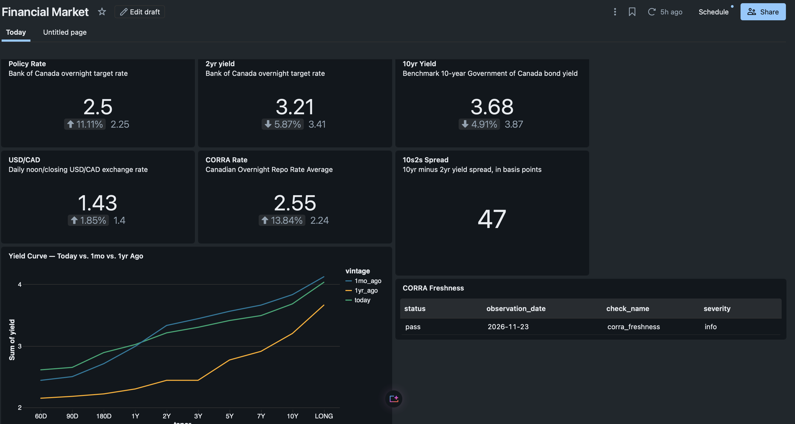

# Financial Market Curve

A data pipeline and dashboard built on the Bank of Canada's Valet API,
answering three market-structure questions — plus a Data Health page
showing the DQ checks that most portfolio projects skip:

1. **What were markets expecting?** The yield curve, and how far the
   2-year yield sits from the policy rate.
2. **Did the Bank surprise them?** An event study of every decision day
   (holds included — not just the rate changes).
3. **Did the policy rate reach the money market?** CORRA vs. the target
   rate, shown as a distribution, not a single line.

## Live dashboard



https://dbc-66d59558-d082.cloud.databricks.com/dashboardsv3/01f1e86b38051ec1a78f91dcb9a53f69/published?o=7474655803730221

## Data quality, not just data

Every build runs a DQ suite (curve-integrity checks, holiday-aware
completeness, revision detection, a median/MAD jump check, schema-drift
detection) and materializes the results into a queryable table rather than
just pass/failing silently in CI.

## Status

**Working end to end:**
- Daily ingestion (GitHub Actions cron → Unity Catalog Volume), chained
  directly into a Databricks Workflows job (dbt build + DQ checks) via the
  Jobs API — no second, independently-drifting schedule.
- dbt silver → gold star schema, decision calendar (81 manually-verified
  BoC announcements, 2017–2026), CORRA-vs-target with real Bank fallback
  methodology, benchmark-bond switch detection, revision tracking.
- "Today" Lakeview dashboard page — live counter tiles, yield curve
  comparison chart, DQ status table.

**In progress:**
- PCA decomposition of yield-curve moves (level/slope/curvature) —
  `jobs/pca_curve_factors.py` is written and wired into the Databricks job
  chain, currently being debugged.
- Remaining 4 dashboard pages (curve over time, decision days, money
  market plumbing, data health) — specs are written in
  `dashboards/lakeview/`, not yet built in the workspace UI.
- Headless CI (`dbt build` on every push) — blocked on Databricks service
  principal / OAuth M2M auth, since this workspace rejects freshly-minted
  personal access tokens; currently gated off via a repo variable.

## Architecture

```
Bank of Canada Valet API
  -> GitHub Actions (daily cron, Python)
  -> Unity Catalog Volume (bronze, raw JSON + pull timestamp)
  -> Databricks Workflows job (sequential tasks):
       dbt run-operation land_bronze_files / land_dq_results_files
       dbt build --exclude gold_pca_curve_factors
       python jobs/pca_curve_factors.py
       dbt run --select gold_pca_curve_factors
  -> Databricks AI/BI (Lakeview) Dashboards, 5 pages
```

See [docs/architecture.md](docs/architecture.md) for more details, and [docs/data_dictionary.md](docs/data_dictionary.md) for
the gold-layer tables.

## Design decisions

- **Decision calendar is a seed, not derived data.** Deriving "decision
  days" from rate changes would silently drop every hold — the calendar
  is manually compiled from the Bank's published schedule instead.
- **RRB benchmark is resolved dynamically, every run**, not hardcoded —
  issuance stopped in 2022, so the "current" benchmark bond is a Bank
  designation that can't be assumed stable indefinitely.
- **Revision tracking starts from day one of the daily cron**, keyed on
  `(observation_date, pull_date)` — not something that can be
  retrofitted onto backfilled history, since the historical endpoint only
  returns already-settled values.
- **CORRA is shown as a distribution** (percentile band + volume +
  fallback-rate flag), since a single daily print hides how thin the
  underlying repo market was that day.

## Tech stack

Python (ingestion, DQ logic, PCA) · GitHub Actions (cron, CI) · Databricks
(Unity Catalog, serverless SQL warehouse, Workflows jobs) · dbt-databricks
(silver/gold transforms + tests) · Databricks AI/BI (Lakeview) dashboards.

## Getting started

1. **Phase 0** — [docs/setup_databricks_free_edition.md](docs/setup_databricks_free_edition.md): one-time Databricks account/catalog/warehouse setup, then add the resulting secrets to this repo's GitHub Actions settings.
2. **Ingestion + tests** work with no cloud account: `pip install -r requirements-dev.txt && pytest tests/ -v`.
3. **Historical backfill (once, before step 4)** — trigger `.github/workflows/backfill.yml` manually, or `python -m ingestion.backfill`.
4. **Turn on the daily cron** — trigger `.github/workflows/ingest.yml` manually once to confirm it lands data, then let the schedule take over.
5. **dbt build** — `cd dbt && dbt seed && dbt run-operation land_bronze_files && dbt run-operation land_dq_results_files && dbt build`.
6. **Dashboards** — build in the Databricks workspace UI following [dashboards/lakeview/](dashboards/lakeview/).

## Repo layout

- `ingestion/` — the Valet API pull, run daily by `.github/workflows/ingest.yml`.
- `tests/` — pytest for the ingestion layer (no live network calls, no cloud account needed).
- `dbt/` — silver/gold transforms, seeds, and DQ tests.
- `jobs/` — the PCA Python job (not expressible in dbt SQL).
- `dashboards/lakeview/` — build specs for the 5 dashboard pages.
- `docs/` — setup, architecture, and data dictionary.
